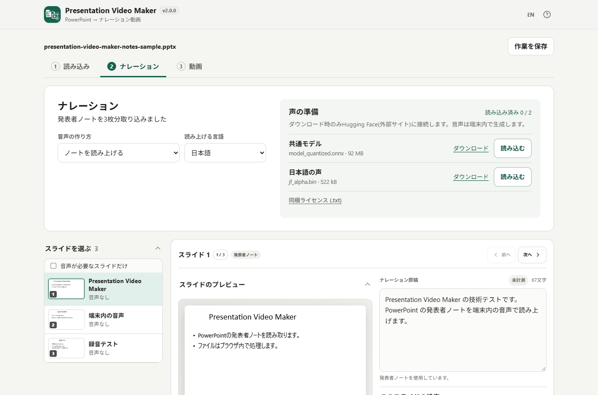

# Presentation Video Maker

[](https://github.com/ttomohisa/htmlapps-presentation-video-maker/actions/workflows/deploy-pages.yml)
[](LICENSE)
[](https://ttomohisa.github.io/htmlapps-presentation-video-maker/)

[English README](README.md)

PowerPoint（PPTX）をブラウザで読み込み、ナレーション付きMP4へ変換する、単一HTML・完全ローカル処理のツールです。PCでは端末内読み上げ・自分の声・ローカル音声ファイルを使い分けられ、スマートフォンではマイク録音または音声ファイルを使ってPPTX読み込みからMP4保存まで進められます。作業はローカル `.pvm` プロジェクトとして保存・再開できます。PPTX・発表者ノート・音声・BGM・プロジェクト・生成動画をアプリからサーバーへ送信しません。

## 発表者ノートを日本語・英語で読み上げる

対応ブラウザで「PowerPointを開く」を選ぶと、取り込んだ発表者ノートの枚数が「ナレーション」に表示されます。スマホでは「音声の作り方」で「ノートを読み上げる」を選びます。「声の準備」からモデルと使う言語の声をダウンロードし、「モデルと声を選ぶ」で保存したファイルを開きます。

| ファイル | 用途 |
| --- | --- |
| `model_quantized.onnx`（92.4 MB） | 日本語と英語で共用するKokoro-82M v1.0本体 |
| `jf_alpha.bin`（522 kB） | 日本語ナレーション |
| `af_heart.bin`（522 kB） | 米国英語ナレーション |

資料の読み上げ言語を選び、別の言語で読むスライドは「このスライドの設定」で切り替えます。「3枚分の音声を作る」のように、残っている枚数がボタンに表示されます。先に1枚作って聞いた場合、その音声はMP4に使われ、残りだけをまとめて作れます。生成した音声は作業ファイル（.pvm）に保存でき、次回はそのまま試聴・MP4出力できます。音声を作り直すときは、モデルと声を選び直します。モデルとHTMLを保存しておけばオフラインでも使えます。[モデルの利用条件と出典](https://huggingface.co/hexgrad/Kokoro-82M)・[検証対象ファイルの配布元](https://huggingface.co/onnx-community/Kokoro-82M-v1.0-ONNX/tree/1939ad2a8e416c0acfeecc08a694d14ef25f2231)

日本語の台本では、`Presentation` や `PowerPoint` はカタカナで読み、`API` や `PDF` は一文字ずつ読みます。英語の辞書にない単語は、綴りから発音を推定します。固有名詞などで推定した読みが合わない場合は、台本に読みをカタカナで入力できます。

## 🚀 デモ

### [GitHub PagesでPresentation Video Makerを開く](https://ttomohisa.github.io/htmlapps-presentation-video-maker/)

GitHub Pages版では最初のHTML取得だけ通信します。読み込み後のPPTX解析、発表者ノート抽出、スライド描画、台本編集、音声処理、動画組み立て、MP4変換は端末内で行います。アプリで選択したファイルはアップロードしません。

[](https://ttomohisa.github.io/htmlapps-presentation-video-maker/)

## 主な機能

- **発表者ノートをそのままナレーション台本に** — 1スライドを1シーンとして扱い、ノートがあれば台本へ、なければスライド本文を下書きとして使用します。
- **スライドごとに音声方式を選択** — 日本語・米国英語のローカルTTSモデル、端末内読み上げ、マイク録音、音声ファイルを同じ資料で使えます。
- **途中保存してあとから再開** — 元のPowerPoint、台本、録音、BGM、出力設定をローカル `.pvm` プロジェクトにまとめて保存し、あとから続きを開けます。生成済みMP4はプロジェクト内へ重複保存しません。
- **未完了シーンをすぐ見つける** — スライド一覧を「音声が必要なスライドだけ」に絞り込めます。動画画面から音声が必要なスライドへ戻れます。
- **台本・字幕を書き出し** — 台本をTXT、現在の動画タイムラインに合わせた字幕をSRT / VTTでローカル保存できます。
- **ナレーションをシーン単位で編集** — 台本、動画への含有、前後余白、音声、読み上げ速度を保持し、設定変更後は古い録音を削除せず「再録音が必要」として管理します。
- **PowerPointを高品質表示** — `@aiden0z/pptx-renderer@1.2.4` でプレビューし、動画用スナップショットは `html2canvas@1.4.1` でorigin-clean Canvasへ変換します。
- **MP4までブラウザ内で作成** — 720p / 1080p、カット / フェード、字幕焼き込み、ローカルBGMに対応します。対応環境ではWebCodecsで高速生成し、利用できない場合は従来のMediaRecorder + FFmpeg WASM経路へ自動的に切り替わります。
- **スマートフォン向けワークフロー** — スマホでは「読み込み / ナレーション / 動画」の順で作業を進め、新規PPTXは「自分の声」を初期音声方式にします。720pを初期値にし、動画生成時はスライド画像を順次処理してメモリ使用量を抑えます。
- **単一HTML・完全ローカル処理** — 必要なランタイムをHTMLへ埋め込み、日本語 / 英語UI、`connect-src 'none'`、実行時CDNなし、解析・テレメトリなし、クラウドTTS APIなしで動作します。

## スマートフォンでの利用

スマートフォンでも対応ブラウザで、資料を開いてナレーション付きMP4を作れます。

1. PPTXまたは `.pvm` を開く
2. 台本を編集する
3. **ノートを読み上げる**を選んで音声を作る、**自分の声**を録音する、または**音声ファイル**を使う
4. 字幕 / BGM / フェードなどを設定する
5. 720pを基本にMP4を作成して保存する

「ノートを読み上げる」はKokoroで動画用の音声を端末内で作ります。ブラウザの「声の見本を聞く」はスマホでも使える場合があります。端末内読み上げを録音する機能は、PC版Chrome / Edgeの「画面全体 + システム音声」を使います。

スマホでは720pを推奨します。1080pも選択できますが、端末メモリを大きく使用するため、長いプレゼンでは生成に失敗する場合があります。動画生成中は対応端末でWake Lockを要求し、画面スリープを抑制します。

## クイックスタート

### Webデモを使う

[GitHub Pages版](https://ttomohisa.github.io/htmlapps-presentation-video-maker/)を開くだけです。登録・インストールは不要です。

### 単一HTMLを使う

1. [GitHub Releases](https://github.com/ttomohisa/htmlapps-presentation-video-maker/releases) から単一HTMLをダウンロードするか、下記手順で `dist/index.html` をビルドします。
2. PCでは現行のChrome / Edge、スマホでは現行のSafari / Chromeなど対応ブラウザで開きます。
3. Windowsの端末内読み上げを録音する場合は、アプリの案内に従って **「画面全体」** を選び、**「システム音声も共有」** を有効にします。

### 完全埋め込み版を自分でビルドする

1. Windowsでこのリポジトリをダウンロードまたはcloneします。
2. 初回は `prepare-and-build.bat` を実行します。
3. `dependencies.json` で固定した依存を取得し、lockとSHA-256を検証して単一HTMLへ埋め込みます。
4. 依存準備後の通常ビルドは `build-standalone.bat` を使用できます。
5. 生成された `dist/index.html` を好きな場所へコピーして利用できます。

通常のWindowsビルドにNode.js、Python、ローカルWebサーバーは不要です。PowerShellとWindows標準の `tar.exe` を使用します。

## 使い方

1. **読み込み** — 「PowerPointを開く」で .pptx を選ぶか、ファイルをドロップします（150 MBまで）。前回の作業を再開する場合は「保存した作業を開く（.pvm）」を選びます。
2. **ナレーション** — 発表者ノートから作る音声の言語を選び、モデルと声の準備ができたら必要なスライドの音声をまとめて作ります。ノートがなければ、取り込んだスライド本文を「台本を確認」から見直せます。
3. **個別に直す** — スライド一覧から選び、台本を編集します。「このスライドの設定」では、読み方、速度、余白、動画に含めるかどうか、音声の方法を変えられます。自分の声を録音したり音声ファイルを選んだりすることもできます。
4. **パソコンの声を録音する場合** — 音声の方法を変え、録音する声を選びます。Windowsの共有画面で「画面全体」と「システム音声も共有」を選びます。録音中は通知や他のアプリの音も入ることがあります。
5. **動画** — 「MP4を作る」を押します。字幕、BGM、スライドの切り替えは「仕上げの設定」で調整できます。完成したら再生して「MP4を保存」。次回も編集するなら、別途「作業を保存」で .pvm を保存します。

## プロジェクト保存と台本・字幕書き出し

`.pvm` には元のPPTX、シーンごとの台本・設定、生成・録音した音声、BGM、動画出力設定が入ります。v2.0.0でv1.xのプロジェクトも開けます。モデルと書き出したMP4は別ファイルです。

`.pvm` の作成・読み込みもブラウザ内だけで行い、プロジェクト内容を外部へ送信しません。自動保存ではないため、再開ポイントを残したいタイミングで明示的に保存してください。

「動画」の「台本・字幕を書き出す」から次のファイルも保存できます。

- `TXT` — スライド単位のナレーション台本
- `SRT` — 現在のシーン/動画タイムラインに合わせた字幕
- `VTT` — 同じタイミングをWebVTT形式で出力した字幕

録音済み・実測済みシーンではその時間を使い、未計測シーンでは現在の推定時間を使って字幕タイミングを計算します。「台本・字幕を書き出す」の「字幕プレビュー」を開き、SRT / VTTを選ぶと、保存する字幕の全文と件数を確認できます。プレビューは読み取り専用で、台本、対象シーン、前後の余白、音声の長さ、切り替え設定の変更に追従します。原稿は台本欄で編集してください。プレビューを開くだけでは保存されません。

プレビューはダウンロードと同じ変換処理を使います（表示には不可視のUTF-8 BOMを含めません）。時刻はミリ秒単位に丸め、秒・分・時への繰り上がりを正しく反映します。字幕の区切りごとの均等配分と既存のカット時45ミリ秒の間隔は維持するため、焼き込み字幕や高速動画生成のタイミングとは異なる場合があります。

## 動画生成の仕組み

動画は完全ローカルで2段階に生成します。

1. スライドを描画し、Canvas / Web Audio上でナレーション、字幕、フェード、BGMをタイムラインに合わせて再生しながらMediaRecorderで中間WebMを作成します。この工程はタイムラインを実際に再生して録画するため、おおむね動画の長さと同程度の時間がかかります。
2. 同梱している FFmpeg WASM Builder v1.6.0 `video-compressor` のランタイムで、中間WebMをH.264/AAC MP4へ変換します。

新しい動画が正常に完成するまでは、以前に作成したMP4を保持します。出力設定を変更した場合は「以前の設定で作成された動画」として残り、再生成をキャンセル・失敗した場合も前の成功済みMP4は消えません。

## PowerPoint表示

高品質プレビューには次を使用します。

```text
@aiden0z/pptx-renderer@1.2.4
```

動画用スナップショットには次も使用します。

```text
html2canvas@1.4.1
```

どちらもバージョンを固定し、SHA-256 lockを作成してビルド時だけ取得し、生成HTMLへ埋め込みます。動画側は `foreignObjectRendering: false` を使用し、`file://` / opaque originで発生したSVG `foreignObject` 経由のCanvas汚染を避けています。

## GitHub Pagesで公開する

リポジトリには `dist/` をビルドしてGitHub Pagesへ配信するworkflowが含まれています。

1. `ttomohisa/htmlapps-presentation-video-maker` としてGitHubへpushします。
2. **Settings → Pages → Build and deployment → Source** で **GitHub Actions** を選択します。
3. `main` へpushするか、Actionsから **Deploy standalone app to GitHub Pages** を手動実行します。
4. デプロイ成功後は `https://ttomohisa.github.io/htmlapps-presentation-video-maker/` で利用できます。

デプロイ時も固定依存から単一HTMLを再生成し、検証後に公開します。

## 開発・ビルド構成

```text
.
├─ src/index.template.html                 # アプリ本体テンプレート
├─ app.config.json                         # アプリ情報・リリース版数
├─ dependencies.json                       # 固定するブラウザ依存
├─ dependencies.lock.json                  # 解決済み依存・ハッシュ
├─ vendor/ffmpeg-video-compressor-v1.6.0/  # FFmpegランタイム
├─ build-standalone.bat                    # 通常ビルド
├─ prepare-and-build.bat                   # 依存準備 + ビルド
├─ dist/index.html                         # 読みやすい単一HTML
├─ dist/index.self-extract.html            # 圧縮自己展開版
└─ .github/workflows/
   ├─ build-standalone.yml                 # PR時の検証
   ├─ dependency-updates.yml               # 依存更新チェック
   └─ deploy-pages.yml                     # GitHub Pages配信
```

### 依存を更新する

`dependencies.json` の固定バージョンを更新し、次を実行します。

```bat
prepare-and-build.bat
```

ビルドでは以下を行います。

- npm tarballをビルド時だけ取得
- `dependencies.lock.json` にSHA-256を記録・検証
- PowerPoint rendererとhtml2canvasを単一HTMLへ埋め込み
- MP4変換用FFmpeg runtime/coreを埋め込み
- 未解決placeholderや実行時外部script / stylesheetを検出
- `dist/dependency-manifest.json` を生成
- 自己展開版単一HTMLを生成・検証

## プライバシー / 外部通信

HTML読込後は **完全ローカル処理** を前提としています。

- PPTXはブラウザのメモリ内で読み込みます。
- 発表者ノート、台本、`.pvm` プロジェクトはサーバーへ送りません。
- マイク録音、システム音声録音、ローカル音声ファイル、BGMは端末内に留まります。
- 中間WebMと生成MP4も外部送信しません。
- CSPは `connect-src 'none'` を維持します。
- 実行時CDN、アクセス解析、テレメトリ、クラウドTTS API、外部フォントを使用しません。

GitHub Pages版は最初のHTML取得には通信が必要です。ネットワークなしで利用する場合は、生成済み `dist/index.html` をローカルで開いてください。

### 高速動画生成

対応ブラウザでは、H.264 / AAC を WebCodecs で端末内エンコードし、アプリ内蔵のISO BMFF mux処理でそのままMP4へまとめます。高速経路では中間WebMを作らず、FFmpeg WASMも起動しません。また、スライドが変化しない区間は同じ画像を30fpsぶん繰り返しエンコードせず、1フレームをその表示時間だけ保持します。字幕が切り替わる時点とフェード中だけ必要なフレームを追加します。対応していない環境や高速経路で処理できない場合は、v1.2.0までの互換動画生成へ自動的に切り替わります。どちらの経路でも外部サーバーへファイルや音声を送信しません。

## 制限事項

- PowerPointのアニメーションは静止状態で表示し、再生しません。
- PowerPoint本体のスライド切り替え効果は再現せず、動画出力ではアプリ独自のカット / フェードを使用します。
- PowerPointへ埋め込まれた音声・動画は再生しません。
- Microsoft PowerPointとの完全なピクセル一致は保証しません。
- Web Speech APIの音声とシステム音声共有はOS・ブラウザ依存です。確認済みのTTS録音方式はWindowsの **「画面全体 + システム音声」** です。**スマートフォンではTTS録音を利用できません。**
- システム音声にはWindows通知や他アプリの音も入る可能性があります。
- `.pvm` は明示的に保存するローカル作業ファイルで、プレゼン内容をLocalStorage / IndexedDBへ自動保存しません。
- SRT / VTTのタイミングは現在のアプリ内タイムラインを基準にし、未録音・未計測シーンでは推定ナレーション時間を使う場合があります。
- WebCodecsのH.264/AACエンコードを利用できない環境では互換経路へ切り替わり、MediaRecorderでタイムラインを実時間再生するため、動画の長さと同程度以上の生成時間がかかる場合があります。
- 大きなPPTX、複雑なスライド、1080p動画は端末メモリを多く使用する場合があります。スマホでは720pを推奨し、v1.2.0では動画用スライド画像を順次作成・解放する低メモリ経路を使用します。
- 現在はPPTX 1ファイル最大150 MB、ナレーション/BGM音声は各100 MBまでです。

## 依存ライブラリ

| ライブラリ / ランタイム | バージョン | ライセンス | 用途 |
| --- | ---: | --- | --- |
| @aiden0z/pptx-renderer | 1.2.4 | Apache-2.0 | PPTX解析・高品質DOM/SVGプレビュー |
| html2canvas | 1.4.1 | MIT | 動画用スライドをorigin-clean Canvasへ変換 |
| ONNX Runtime Web | 1.31.1 | MIT | Kokoroモデルのローカル推論 |
| ephone / eSpeak NG | 1.0.2 | GPL-3.0-or-later | 辞書にない英単語の発音推定 |
| FFmpeg WASM Builder生成core | Builder 1.6.0 / `video-compressor` | GPL-2.0-or-later | WebCodecs非対応時の互換経路でH.264/AAC MP4へ変換 |

辞書と各ランタイムの出典、ライセンス、対応ソースは [THIRD_PARTY_NOTICES.md](THIRD_PARTY_NOTICES.md) を参照してください。

## Contributing

不具合報告・機能提案はGitHub Issuesで受け付けます。開発方法は [CONTRIBUTING.md](CONTRIBUTING.md) を参照してください。

### アプリの回帰テスト

Node.js 20以降で `node --test tests/*.test.cjs` を実行します。標準の `scripts/check-repository.ps1` は全アプリテストをソースに対して実行し、ビルド後の読みやすいHTMLに対しても再実行します。ビルドでは自己展開版が同じHTMLのバイト列へ復元されることも検証します。別の読みやすいHTMLを指定する場合は `PVM_TEST_HTML` を使用できます。追加依存のないテストで、実際の関数・イベント処理をDOM・メディアのテスト用代替と組み合わせて確認し、ヘルプの静的なレイアウト条件も検査します。PC・スマホでの実際のホイール、フォーカス、画面サイズ、実メディアの検証を置き換えるものではありません。

## License

Copyright © 2026 ttomohisa

[GNU General Public License v3.0](LICENSE) で公開します。
