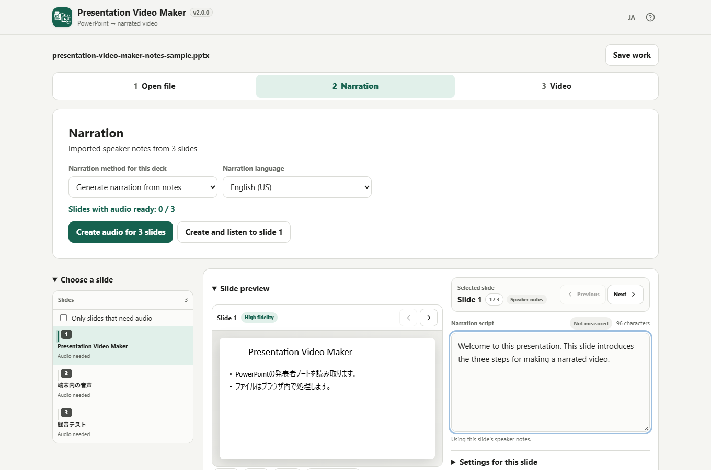

# Presentation Video Maker

[](https://github.com/ttomohisa/htmlapps-presentation-video-maker/actions/workflows/deploy-pages.yml)
[](LICENSE)
[](https://ttomohisa.github.io/htmlapps-presentation-video-maker/)

[日本語版 README](README.ja.md)

A privacy-focused, single-HTML app for turning a PowerPoint (PPTX) deck into a narrated MP4 in the browser. Use on-device speech, your own microphone recording, or local audio files, save/resume the work as a local `.pvm` project, and export scripts/subtitles without uploading the presentation, narration, BGM, project, or generated video to the app.

## Generate Japanese and English narration from speaker notes

Open a PowerPoint in desktop Chrome or Edge. In **Narration**, download the shared model and the voice for your language, then use **Select model and voice files** to open them locally.

| File | Used for |
| --- | --- |
| `model_quantized.onnx` (92.4 MB) | Kokoro-82M v1.0 |
| `jf_alpha.bin` (522 kB) | Japanese narration |
| `af_heart.bin` (522 kB) | US English narration |

Choose the deck’s narration language or set a different language for one slide. Create the batch in one go, or create and listen to one slide first. The sample becomes part of the video and the batch skips it. A saved .pvm includes generated audio, so you can reopen it and export an MP4 before selecting the model files again. [Model license and credits](https://huggingface.co/hexgrad/Kokoro-82M) · [Pinned downloads](https://huggingface.co/onnx-community/Kokoro-82M-v1.0-ONNX/tree/1939ad2a8e416c0acfeecc08a694d14ef25f2231)

## 🚀 Live demo

### [Open Presentation Video Maker on GitHub Pages](https://ttomohisa.github.io/htmlapps-presentation-video-maker/)

GitHub Pages delivers the initial HTML. After it loads, PPTX parsing, speaker-note extraction, slide rendering, narration editing, audio handling, video composition, and MP4 conversion are processed locally on your device. Files selected in the app are not uploaded by the app.

[](https://ttomohisa.github.io/htmlapps-presentation-video-maker/)

## Features

- **Turn speaker notes into narration** — Each PowerPoint slide becomes one scene, with speaker notes used as the initial script and slide text used as a fallback draft when notes are missing.
- **Choose narration per slide** — Mix local model synthesis, on-device browser speech, microphone recordings, and existing audio files. The local model reads Japanese and US English and can infer the pronunciation of unfamiliar English words in Japanese scripts.
- **Resume work later** — Save the source PowerPoint, scripts, narration recordings, BGM, and output settings into a local `.pvm` project and open it later. Project data is not uploaded and generated MP4 is not duplicated inside the project.
- **Find unfinished narration quickly** — See ready/unrecorded/stale/failed counts and jump directly to the next scene that needs attention.
- **Export scripts and subtitles** — Save the current scripts as TXT or export the current video timeline as SRT / VTT for use outside the app.
- **Keep narration work editable** — Adjust scripts, include/exclude slides, before/after padding, voice, and speech rate, with stale-audio tracking when narration settings change.
- **Preview PowerPoint with higher fidelity** — Use pinned `@aiden0z/pptx-renderer@1.2.4` for the main slide preview and `html2canvas@1.4.1` for origin-clean video snapshots.
- **Create a finished MP4 locally** — Choose 720p or 1080p, Cut or Fade, burned-in subtitles, and optional local BGM. Supported browsers use accelerated WebCodecs export; other environments automatically keep the established MediaRecorder + FFmpeg WASM compatibility path.
- **Smartphone workflow** — Smartphones use the Open file / Narration / Video workflow, default new slides to microphone recording, start video output at 720p, and stream slide snapshots during export to reduce peak memory.
- **Private, single-HTML operation** — Runtime libraries are embedded, the UI is Japanese/English, and the app keeps `connect-src 'none'` with no runtime CDN, analytics, telemetry, or cloud TTS API.

## Smartphone use

v1.2.0 introduced the smartphone workflow for:

1. opening PPTX or `.pvm`;
2. editing scripts;
3. recording **My voice** or assigning a local **Audio file** per scene;
4. configuring subtitles / BGM / transitions;
5. creating and saving MP4, with 720p recommended.

> **TTS/on-device speech cannot be recorded on smartphones.** Speech preview can still work, but the app cannot capture that synthesized voice as a narration asset on mobile. Use **My voice** or **Audio file** for smartphone video narration. TTS capture remains a desktop Chrome / Edge workflow using Entire Screen + system audio.

720p is the smartphone default. 1080p remains selectable but has much higher memory pressure. During smartphone export, slide snapshots are created and released progressively instead of retaining the entire deck in rasterized form, and Wake Lock is requested where available.

## Quick start

### Use the web demo

Open the [GitHub Pages demo](https://ttomohisa.github.io/htmlapps-presentation-video-maker/). No account or installation is required.

### Use the single HTML file

1. Download the standalone `.html` file from [GitHub Releases](https://github.com/ttomohisa/htmlapps-presentation-video-maker/releases), or build `dist/index.html` locally.
2. Open it in a current Chromium-based browser.
3. For the Windows Web Speech API recording workflow, follow the in-app instructions to share **Entire Screen** and enable **system audio** when requested.

### Build a fully embedded file yourself

1. Download or clone this repository on Windows.
2. Double-click `prepare-and-build.bat` for the first build.
3. The builder downloads the exact dependency versions pinned in `dependencies.json`, verifies the lock data, and embeds them into the standalone HTML.
4. After dependencies are prepared, `build-standalone.bat` can be used for normal rebuilds.
5. Copy `dist/index.html` wherever you need it.

Node.js, Python, and a local web server are not required for the normal Windows build. The repository build uses PowerShell and the built-in `tar.exe`.

## Usage

1. **Open file** — Open or drop a .pptx file (up to 150 MB). To resume, use **Open saved work (.pvm)**.
2. **Narration** — Choose a language and prepare the voice files, then create audio for all remaining slides. When a slide has no notes, **Check script** opens the draft made from the slide text.
3. **Edit a slide** — Pick a slide from the list. **Settings for this slide** includes its narration method, language, speed, timing and inclusion. You can record your voice or select a local audio file.
4. **Record computer speech on Windows** — Choose a local system voice, then select **Entire Screen** and **Share system audio** when prompted. Other sounds from your computer may also be recorded.
5. **Video** — Create the MP4, preview it and select **Save MP4**. Find subtitles, background music and transitions under **Finishing settings**. Select **Save work** to keep a separate .pvm for future edits.

## Project files and text exports

`.pvm` holds the source PPTX, scene scripts and settings, generated or recorded narration, optional BGM, and output settings. v2.0.0 opens v1.x projects. Model files and the exported MP4 stay separate from the project.

The project container is written and read locally by the app; no project data is sent to a server. It is not an autosave format, so save a new `.pvm` file when you want a resumable checkpoint.

The output area can also save:

- `TXT` — narration scripts grouped by slide;
- `SRT` — subtitle cues using the current scene/timeline timing;
- `VTT` — the same cue timing in WebVTT format.

When a scene has a measured/recorded narration duration it is used for subtitle timing; otherwise the current duration estimate is used. Open **Subtitle preview** in the output area and choose SRT / VTT to inspect the complete download text and cue count before saving. The preview is read-only and updates as scripts, included scenes, padding, audio duration, and transition settings change. Edit narration in the script field; opening the preview does not download anything.

The preview shares the download serializer (the invisible UTF-8 BOM is omitted from display). Timestamps round to whole milliseconds with correct second/minute/hour carry. Exported cue timing keeps equal segment durations and the existing 45 ms Cut gap, so it may differ from burned-in subtitles and the accelerated video timeline.

## Video creation pipeline

Video creation is fully local and uses two stages:

1. The browser renders the included slides, plays scene narration on a Canvas/Web Audio timeline, mixes optional BGM, burns subtitles, and records an intermediate WebM with MediaRecorder. This composition stage runs approximately in real time because the timeline is captured while it plays.
2. The embedded FFmpeg WASM Builder v1.6.0 `video-compressor` runtime converts the intermediate WebM to H.264/AAC MP4.

The generated MP4 replaces the previous result only after a new export succeeds. Changing output settings marks the previous video as outdated but keeps it available; a cancelled or failed replacement export also keeps the prior successful MP4.

## PowerPoint rendering

The primary preview uses:

```text
@aiden0z/pptx-renderer@1.2.4
```

Video snapshots additionally use:

```text
html2canvas@1.4.1
```

Both are pinned, SHA-256 locked, downloaded only during the repository build, and embedded into the generated HTML. The video snapshot path uses `foreignObjectRendering: false` to avoid the Canvas tainting problem observed with SVG `foreignObject` under `file://` / opaque-origin environments.

## Publish with GitHub Pages

The repository includes a workflow that builds the standalone HTML and deploys `dist/` to GitHub Pages.

1. Push the repository to GitHub as `ttomohisa/htmlapps-presentation-video-maker`.
2. Open **Settings → Pages → Build and deployment → Source** and select **GitHub Actions**.
3. Push to `main`, or manually run **Deploy standalone app to GitHub Pages** from the Actions tab.
4. After a successful deployment, the demo is available at `https://ttomohisa.github.io/htmlapps-presentation-video-maker/`.

Each deployment rebuilds the generated HTML from pinned dependencies and validates the repository before publishing.

## Development and build layout

```text
.
├─ src/index.template.html                 # Application template
├─ app.config.json                         # App metadata and release version
├─ dependencies.json                       # Pinned browser dependencies
├─ dependencies.lock.json                  # Resolved dependency hashes
├─ vendor/ffmpeg-video-compressor-v1.6.0/  # Embedded FFmpeg runtime assets
├─ build-standalone.bat                    # Normal standalone build
├─ prepare-and-build.bat                   # Dependency preparation + build
├─ dist/index.html                         # Readable single-HTML artifact
├─ dist/index.self-extract.html            # Compressed self-extracting artifact
└─ .github/workflows/
   ├─ build-standalone.yml                 # Pull-request validation
   ├─ dependency-updates.yml               # Scheduled dependency checks
   └─ deploy-pages.yml                     # GitHub Pages deployment
```

### Update dependencies

Update the pinned versions in `dependencies.json`, then run:

```bat
prepare-and-build.bat
```

To discard cached npm packages and retrieve them again, run the PowerShell builder with `-ForceDownload` through the repository build flow.

The build process:

- Downloads pinned npm tarballs during build time only
- Records and verifies SHA-256 hashes in `dependencies.lock.json`
- Embeds the PowerPoint renderer and html2canvas into the standalone HTML
- Embeds the FFmpeg runtime/core required for MP4 conversion
- Rejects unresolved build placeholders and external runtime script/style references
- Generates `dist/dependency-manifest.json`
- Generates and verifies the self-extracting single-HTML variant

## Privacy and runtime network protection

The generated app is designed for **fully local processing** after the HTML has loaded:

- Selected PPTX files are read in browser memory.
- Speaker notes, scripts, and `.pvm` project files are not sent to a server.
- Microphone recordings, system-audio recordings, local audio files, and BGM remain on the device.
- Intermediate WebM and generated MP4 data remain local.
- CSP includes `connect-src 'none'`.
- Runtime CDN, analytics, telemetry, cloud TTS APIs, and external fonts are not used.

The GitHub Pages version still requires the initial HTML request. To use the app without a network connection, open the generated `dist/index.html` locally.

### Accelerated video export

On supported browsers, H.264 and AAC are encoded locally with WebCodecs and written directly into MP4 by the app’s built-in ISO BMFF muxer. The accelerated path does not create an intermediate WebM and does not start FFmpeg WASM. Unchanged slide intervals use variable-duration video samples instead of encoding the same image 30 times per second; new frames are emitted for subtitle changes and during fades. If the browser cannot provide the required codecs or the accelerated path cannot complete, the app automatically falls back to the v1.2.0 compatibility exporter. Neither path uploads presentation or audio data.

## Limitations

- PowerPoint animations are shown as static content and are not replayed.
- Native PowerPoint slide transitions are not replayed; the app provides its own global Cut/Fade option for exported video.
- Embedded PowerPoint audio/video is not played.
- Exact pixel parity with desktop Microsoft PowerPoint is not guaranteed.
- Web Speech API voices and system-audio sharing behavior depend on the browser and operating system. The tested TTS capture workflow uses Windows **Entire Screen + system audio**.
- System-audio capture can include notification sounds, music, or other applications.
- `.pvm` is an explicit local save/resume file; the app does not autosave presentation content to LocalStorage or IndexedDB.
- SRT/VTT cue timing follows the current app timeline and may use estimated narration duration for scenes that have not been measured/recorded yet.
- When H.264/AAC WebCodecs encoding is unavailable, the app falls back to the compatibility exporter; that path uses real-time MediaRecorder composition and may take roughly the video duration or longer.
- Large or complex PowerPoint decks, high-resolution rendering, and 1080p export can consume substantial device memory.
- The current UI accepts one PPTX up to 150 MB and local narration/BGM files up to 100 MB each.

## Dependencies

| Library / runtime | Version | License | Purpose |
| --- | ---: | --- | --- |
| @aiden0z/pptx-renderer | 1.2.4 | Apache-2.0 | PPTX parsing and high-fidelity DOM/SVG preview |
| html2canvas | 1.4.1 | MIT | Origin-clean slide rasterization for video snapshots |
| ONNX Runtime Web | 1.31.1 | MIT | Local Kokoro inference |
| ephone / eSpeak NG | 1.0.2 | GPL-3.0-or-later | Pronunciation rules for unfamiliar English words |
| FFmpeg WASM Builder generated core | Builder 1.6.0 / `video-compressor` | GPL-2.0-or-later | H.264/AAC MP4 conversion on the compatibility fallback |

The speech dictionaries, runtime components, and corresponding sources are documented in [THIRD_PARTY_NOTICES.md](THIRD_PARTY_NOTICES.md).

## Contributing

Bug reports and feature proposals are welcome through GitHub Issues. See [CONTRIBUTING.md](CONTRIBUTING.md) for development guidance.

### Application regression checks

Run `node --test tests/*.test.cjs` with Node.js 20 or later. The canonical `scripts/check-repository.ps1` check runs all application suites against the source and again against the generated readable HTML. The build verifies that the self-extracting payload restores the same readable bytes. `PVM_TEST_HTML` selects another readable HTML for a focused artifact check. These dependency-free tests cover actual source functions and event handlers using DOM/media doubles, plus static Help-layout guards; they do not replace native desktop/mobile wheel, focus, viewport, or real-media testing.

## License

Copyright © 2026 ttomohisa

Licensed under the [GNU General Public License v3.0](LICENSE).
